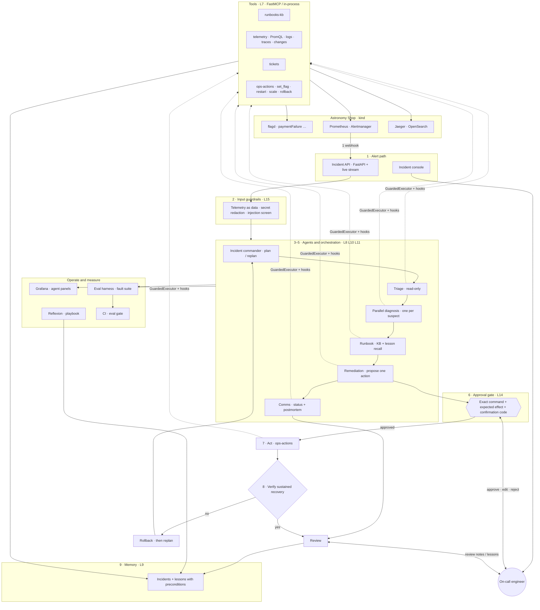
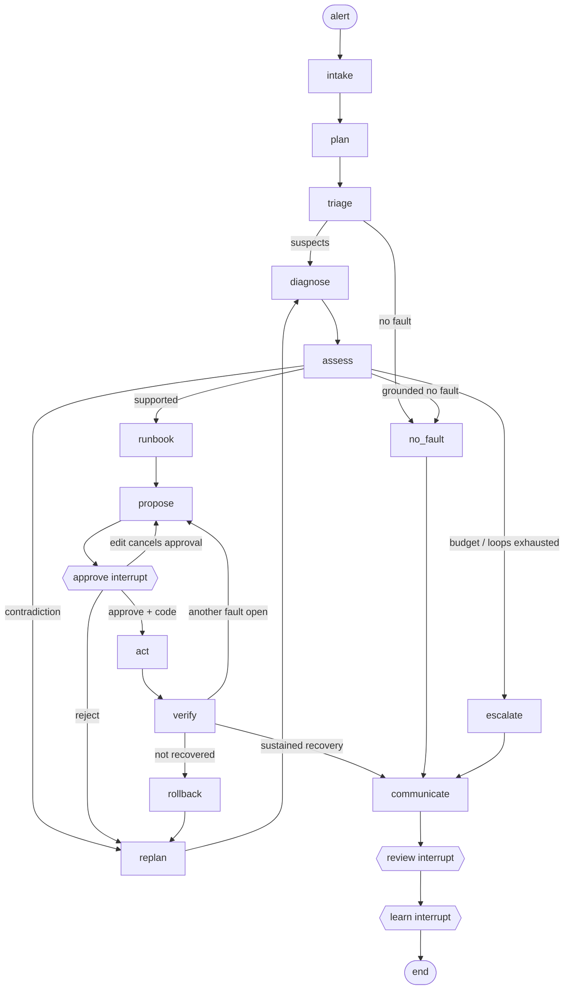

# On-Call Copilot — Architecture

Redrawn for the capstone submission. Numbers in **Figure 1** match the guide’s On-Call Copilot walkthrough. **Figure 2** is the live LangGraph team (C2). A paymentFailure walkthrough follows both figures.

Related detail: [agents/README.md](agents/README.md) (graph internals), [agents/viva.md](agents/viva.md) (viva answers), [agents/graph-c2.mmd](agents/graph-c2.mmd) (compiled export).

---

## Figure 1. System architecture

Who talks to whom when an alert fires. Agents never reach the shop directly: every tool call goes through Role 4’s hooks and guardrails.

| # | Stage | What happens | Lecture |
| --- | --- | --- | --- |
| 1 | Alert path | Alertmanager posts to the incident API; the console streams the investigation | L16 |
| 2 | Input guardrails | Telemetry and retrieved text are treated as data; secrets redacted; injection screened | L15 |
| 3 | Commander | Stronger model writes the plan object shown in the console; cannot skip approve/verify | L10 |
| 4 | Triage + parallel diagnosis | Read-only specialists gather evidence within a shared tool budget | L11 |
| 5 | Runbook + propose | Retrieve runbook/lessons (preconditions checked in code); one allow-listed action, dry-run first | L4–L7 |
| 6 | Approval gate | Engineer approves/edits/rejects the exact command; SEV1 needs two people | L14 |
| 7 | Act | Remediation runs the approved payload once through hooks | L7, L14 |
| 8 | Verify | Code samples expected effect; on failure, approved rollback then replan | L8, L10 |
| 9 | Review + memory | Person reviews notes and lessons; only approved lessons are stored | L9, L12 |

**Safety boundary.** Diagnosis has no write tools. There is no shell and no `docker exec`. Output guardrails require claims to cite evidence ids and refuse secrets in status notes.

---

## Figure 2. Incident graph (C2 team)

Happy path is solid; interrupt and recovery edges are dashed. This is the architecture we run with `COPILOT_AGENT=c2`.

Baselines for E1 use the same outer shell with a different middle:

| Arch | Middle after `plan` | File |
| --- | --- | --- |
| C2 team | `triage` → parallel `diagnose` → `assess` | [graph-c2.mmd](agents/graph-c2.mmd) |
| C1 single | one `investigate` → `assess` | [graph-c1.mmd](agents/graph-c1.mmd) |
| C0 fixed | `fixed` workflow → `assess` | [graph-c0.mmd](agents/graph-c0.mmd) |

Regenerate an export: `python -m graph.cli diagram --arch c2`.

---

## Numbered walkthrough — `paymentFailure`

Case: flag `paymentFailure` on; Prometheus `ServiceErrorRateHigh` for payment/checkout; engineer on the console.

1. **Alert in.** Alertmanager posts to `/webhooks/alert`. Input guardrails screen the payload. The API opens an incident and starts a LangGraph thread whose id is the incident id.
2. **Plan.** The commander writes plan v1 (suspects and order). The console shows the plan object. Fixed steps keep approve and verify on the path.
3. **Triage.** Read-only ReAct specialist reads error ratios, latency, and recent flag changes. Returns a typed `TriageReport` with up to three suspects and evidence ids.
4. **Diagnose in parallel.** One diagnosis specialist per suspect via LangGraph `Send`, sharing a tool-call budget and a read cache. Each returns ranked hypotheses.
5. **Assess (code).** Merge and ground evidence; refute a hypothesis whose flag the change log shows as off. Route to runbook, replan, escalate, or no-fault.
6. **Runbook.** Retrieve the payment-failure runbook and candidate lessons. **Code** applies `check_lesson` so a mismatched old lesson is rejected (demo item 3).
7. **Propose.** Remediation proposes one allow-listed action, e.g. `set_flag(paymentFailure, off)`, with dry run, rollback, expected effect, and confirmation code. `validate_plan` must pass.
8. **Approve (interrupt).** Graph pauses. Engineer approves the exact command (or edits/rejects). Edit cancels the pending approval and forces a new proposal.
9. **Act → verify.** Approved payload runs once. Code samples the expected metric until it holds for three samples (or the window ends). Failure triggers the approved rollback and a replan.
10. **Communicate → review → learn.** Comms drafts status note and postmortem from the trace. Person reviews notes and any lessons before memory write.

Evidence traces: [stop-and-resume](agents/traces/stop-and-resume.md), [replan-real-model](agents/traces/replan-real-model.md), [edit-cancels-approval](agents/traces/edit-cancels-approval.md), [failed-tool](agents/traces/failed-tool.md).

---

## Who decides what

| Decides | Examples |
| --- | --- |
| **Model** | Suspect order, tool use inside budget, hypothesis ranking, which single action to propose, wording of notes |
| **Code** | Evidence grounding, flag-off contradiction, lesson preconditions, severity policy, dry run / rollback / expected effect, sustained recovery, budgets, allow-lists, loops |
| **Person** | Every world-changing action (exact command + code; SEV1 dual control), external notes, every lesson stored |

---

## How to present this

1. Show **Figure 1**, then walk numbers 1→9 on a live `paymentFailure` incident.
2. Zoom to **Figure 2** for stop/resume, edit-cancels-approval, and replan.
3. Point at the safety boundary: diagnosis cannot write; approval is bound to the payload hash.
4. For viva redraw: Alert → API → graph → tools via hooks → shop; interrupts at approve / review / learn.
