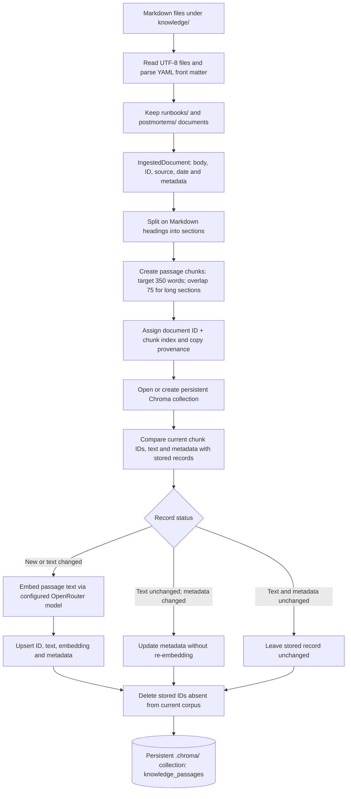
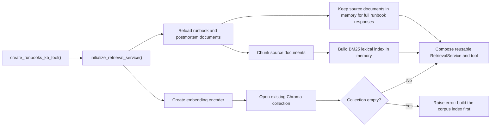
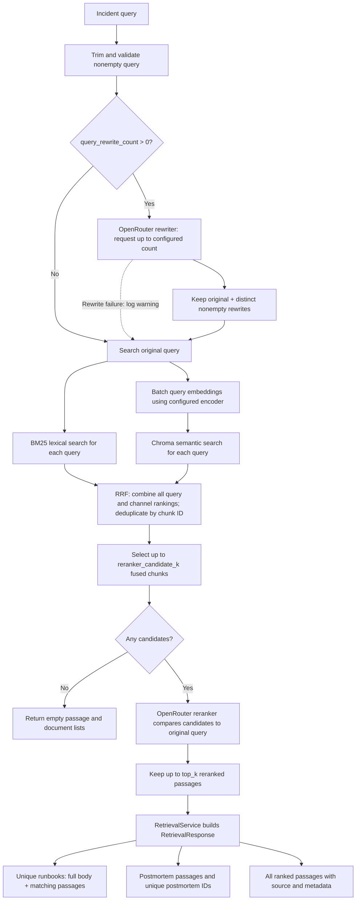

# RAG architecture: ingestion and retrieval

This document describes how the knowledge retrieval component indexes runbooks
and postmortems and returns evidence for an incident query. Indexing and
retrieval are separate operations: starting the retrieval tool does not populate
or refresh the Chroma index.

## 1. Ingestion and persistent indexing

Run the indexer from the repository root when setting up the corpus and after
changing source documents or chunking settings:

```powershell
& .\.venv\Scripts\python.exe -m knowledge.retrieval.build_index
```



### Ingestion details

1. **Load documents.** [`load_markdown_documents`](knowledge/retrieval/ingest.py)
   reads Markdown files recursively and parses front matter into metadata. It
   uses the filename stem when an ID is absent, and the file modification time
   when neither `source_date` nor `date` is present.
   [`load_retrieval_documents`](knowledge/retrieval/build_index.py) retains only
   documents whose sources are under `runbooks/` or `postmortems/`.
2. **Chunk documents.** [`chunk_markdown_documents`](knowledge/retrieval/chunker.py)
   splits around headings. For sections longer than the configured target, it
   creates word-token windows with overlap; these windows are lowercased and
   joined as words. A chunk ID has the form `<document-id>-<index>`; it is
   deterministic for a given document and chunk ordering, but may change when
   earlier chunks are inserted or removed. Each chunk carries its text, ID,
   document ID, source, source date, service, failure family, title, and
   metadata.
3. **Embed and persist.** [`ChromaPassageStore`](knowledge/retrieval/index.py)
   compares chunks with stored records and sends only new or changed passage
   text for embeddings. The default batch size is 32. The configured embedding
   model must be compatible with the collection's stored model. The same
   encoder is later used for query embeddings.
4. **Synchronize deletions.** Stored chunk IDs absent from the current corpus
   are removed. A rerun with no changes does not re-embed unchanged passages.
   The command prints document, chunk, changed-record and collection counts.

The default Chroma directory is `.chroma/` at the repository root, and the
default collection is `knowledge_passages`. The collection stores passage
text, vectors, and citation metadata on disk; it is not the in-memory BM25
index.

## 2. Retrieval service startup

The caller initializes the tool once and reuses the returned object:

```python
from knowledge.retrieval.runbooks_kb_tool import create_runbooks_kb_tool

runbooks_kb = create_runbooks_kb_tool()
```



[`initialize_retrieval_service`](knowledge/retrieval/runtime.py) does not
re-embed or synchronize the corpus. It checks that the collection is nonempty,
not that it is fully up to date. After changing source documents or chunking
settings, rerun indexing and recreate the tool so its in-memory documents and
BM25 index agree with the refreshed Chroma corpus. Initialization is once per
tool creation, not a global singleton: repeated calls to
`create_runbooks_kb_tool()` initialize again unless a service is supplied.

## 3. Retrieval for each incident query



### Example: two rewrites and candidate counts

The checked-in configuration currently sets `query_rewrite_count: 0`.
For this example, **assume it is set to 2**; all other limits below use the
current values in
[`retrieval_config.yaml`](knowledge/retrieval/retrieval_config.yaml).

```text
Original:  Payment authorization requests are failing.
Rewrite 1: Payment authorization failures.
Rewrite 2: Errors processing payment authorization requests.
```

These are illustrative rewrites, not a recorded model response. The rewriter
is instructed to preserve meaning and not invent incident facts. It may return
fewer than two distinct rewrites; if it fails, retrieval logs a warning and
continues with the original query.

| Query | BM25 candidates | Semantic candidates |
|---|---:|---:|
| Original | up to 50 | up to 50 |
| Rewrite 1 | up to 50 | up to 50 |
| Rewrite 2 | up to 50 | up to 50 |
| **Total candidate appearances** | **up to 150** | **up to 150** |

This gives **up to 300 appearances, not necessarily 300 unique chunks**: a
passage can appear in multiple rankings. Some lists can have fewer than 50
items, and a rewrite can be absent or duplicated. Query embeddings for the
active queries are batched for semantic search.

For each chunk, reciprocal rank fusion adds `1 / (rrf_k + rank)` for every
ranking in which it appears; ranks start at 1 and `rrf_k` is currently 60.
For example, a chunk ranked first in one list and fifth in another gets
`1/61 + 1/65`, or approximately `0.0318`. This is a ranking score, not a
probability. The fused list contains each chunk ID once.

```text
Up to 300 candidate appearances across six lists
    -> RRF combines ranks and deduplicates by chunk ID
    -> up to 20 unique chunks go to the reranker
    -> up to 10 reranked passages are returned
    -> passages are organized into RetrievalResponse
```

The reranker compares the selected passage texts against the **original**
query, not against each rewrite. Results and passage counts depend on the
indexed corpus and model responses.

### Response shape

[`RetrievalResponse`](knowledge/retrieval/contracts.py) contains:

| Field | Contents |
|---|---|
| `query` | The trimmed original query. |
| `passages` | Ranked runbook and postmortem passages, including source and citation metadata. |
| `runbook_ids` | IDs of unique matching runbooks. |
| `runbooks` | Each matching runbook's full body, metadata, and matched passages. |
| `postmortem_ids` | Unique IDs of matching postmortems. |
| `postmortem_passages` | Ranked postmortem passages, separate as historical context. |

The response contains retrieval evidence; generating an incident answer or
making an operational decision is outside this retrieval service. The separate
incident-memory subsystem is also outside this pipeline.

## 4. Configuration and operational notes

| Setting | Current value | Purpose |
|---|---:|---|
| `target_words` | 350 | Target for chunk windows. |
| `overlap_words` | 75 | Overlap between windows for oversized sections. |
| `query_rewrite_count` | 0 | Maximum requested alternative query phrasings. |
| `candidate_k` | 50 | Maximum results per query and retrieval channel. |
| `rrf_k` | 60 | RRF rank-smoothing constant. |
| `reranker_candidate_k` | 20 | Maximum fused passages sent to the reranker. |
| `top_k` | 10 | Maximum reranked passages returned. |

Embedding, optional query rewriting, and reranking make calls to configured
OpenRouter services and may incur charges. Rewriting needs a configured
`QUERY_REWRITE_MODEL`; embeddings and reranking also need their respective
model and credential settings. Keep credentials out of source control. The
setup and command-line query example are documented in
[`knowledge/README.md`](knowledge/README.md).

## 5. Main implementation files

- [`build_index.py`](knowledge/retrieval/build_index.py): corpus selection and
  persistent indexing command.
- [`ingest.py`](knowledge/retrieval/ingest.py) and
  [`chunker.py`](knowledge/retrieval/chunker.py): document parsing and chunking.
- [`index.py`](knowledge/retrieval/index.py): embeddings, Chroma, BM25, RRF,
  and reranking.
- [`query_rewriter.py`](knowledge/retrieval/query_rewriter.py): optional
  fact-preserving query alternatives.
- [`runtime.py`](knowledge/retrieval/runtime.py): reusable service startup.
- [`runbooks_kb_tool.py`](knowledge/retrieval/runbooks_kb_tool.py) and
  [`service.py`](knowledge/retrieval/service.py): query adapter and response
  assembly.
- [`contracts.py`](knowledge/retrieval/contracts.py): response data structures.
