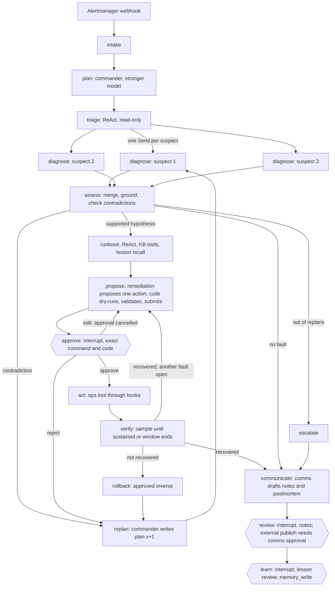

# Agents and Orchestration

| | |
| --- | --- |
| Role | Agents and orchestration engineer (role 3: L8, L10, L11, L12) |
| Owner | _name_ |
| Version | 1.0, 7 November 2026 |
| Config | `agents/config/agents.yaml`, version `2026-11-07.1` |
| Plan | [../agents-and-orchestration-plan.md](../agents-and-orchestration-plan.md) |

This document explains how the incident graph, the commander and the specialists work, how to run them, and where each piece of role 3's evidence is. Evaluation status is in [evaluation.md](evaluation.md), the lesson policy in [playbook.md](playbook.md), runs in [experiment-log.md](experiment-log.md), and viva preparation in [viva.md](viva.md).

**What has and has not been run.**

- **Built and tested:** the code is complete and tested, with 100% line and branch coverage. Every path also runs offline against the shop twin.
- **Run with a real model:** E1 and E4 ran on the 20 development cases against the shop twin (160 model runs, OpenRouter), and Reflexion drafted lessons from the failures. Results are in [evaluation.md](evaluation.md).
- **Still to do:** a person reviews the lesson drafts and freezes the playbook; role 5 runs the held-out cases on the live shop.
- **Scripted-model traces:** these are labelled as mechanism checks. They are not model results.

## 1. Architecture



The exact compiled graphs, exported by LangGraph:

- [graph-c2.mmd](graph-c2.mmd): the team.
- [graph-c1.mmd](graph-c1.mmd): the single agent.
- [graph-c0.mmd](graph-c0.mmd): the fixed workflow.

To regenerate one, run `python -m graph.cli diagram --arch c2`.

### Every tool call goes through the safety layer

```
specialist (ReAct) ──> RoleToolset ──> GuardedExecutor.call_tool ──> hooks ──> backend
                         │                    │                         │
                         │ model args →       │ kill switch, budgets,   │ live client / FastMCP (langchain-mcp-adapters)
                         │ hook args          │ loop detection,         │ or the shop twin (offline)
                         │ cache, evidence,   │ allow-list + typed args,│
                         │ observations       │ approval gate,          │
                         │                    │ telemetry sanitiser     │
```

### Common stack mapping

| Layer | What we use | Where |
| --- | --- | --- |
| Models | OpenRouter: `openai/gpt-4.1` for the commander, `openai/gpt-4.1-mini` for the specialists, a judge from a different family | `agents/config/agents.yaml`, `agents/llm.py` |
| Orchestration | LangGraph `StateGraph`, typed state, conditional edges, `Send` fan-out, SQLite checkpointer, `interrupt()` / `Command(resume=...)` | `graph/incident_graph.py`, `graph/service.py` |
| Long-term memory | LangGraph store (`InMemoryStore`, or `SqliteStore` live) with precondition-checked lessons | `agents/memory/lessons.py` |
| Tools | FastMCP servers loaded with langchain-mcp-adapters (`McpFetch`; descriptions pinned to the repo), or the in-process client | `agents/toolbox.py` |
| Retrieval | BM25 over the runbooks (rank-bm25), or role 2's hybrid service | `KnowledgeBackend` |
| Guardrails | Role 4's hooks, input and output guardrails, approval service; nothing bypasses them | `safety/` |
| Improvement | Reflexion: agent, evaluator (checker code), reflection, human review, freeze | `eval/reflexion.py`, `eval/playbook.py` |
| Evaluation | pytest, a JSONL runner, checker code | `eval/runner.py`, `tests/test_agent_*.py` |
| Observability | JSONL trace per incident, LangSmith or Langfuse callbacks, `prometheus_client` metrics | `agents/observability.py` |
| Serving | Inside the FastAPI incident API (`COPILOT_AGENT`), with the console showing the plan | `graph/live.py`, `incident_api/`, `ui/page.py` |
| Prompts | The six slots from L3 (role, context, task, constraints, format, examples), one versioned file | `agents/config/agents.yaml` |

## 2. One incident, step by step

The case is `paymentFailure` at 50%, with the alert firing on checkout. The numbers match the steps in the trace [traces/stop-and-resume.md](traces/stop-and-resume.md).

1. **Alert in.**
   - Alertmanager posts to `/webhooks/alert`.
   - The incident API screens the payload (role 4) and stores the incident.
   - With `COPILOT_AGENT` set, it starts a graph thread whose thread id is the incident id.
2. **Plan.**
   - The commander (stronger model) writes plan v1: which suspects to test first, and why.
   - The step list is fixed, so the model cannot skip approval or verification.
   - The console shows the plan.
3. **Triage.**
   - A ReAct specialist with read-only tools reads error ratios, latency and recent flag changes.
   - It hands back a typed `TriageReport`: affected services, up to 3 suspects, severity inputs, and the evidence ids it cites.
4. **Diagnose, in parallel.**
   - One diagnosis specialist per suspect, via LangGraph `Send`. Each stays within its share of the budget.
   - Each forms hypotheses (service, fault type, likely flag), gathers evidence for and against, and ranks them in a `DiagnosisReport`.
   - Identical reads are cached and shared between them.
5. **Assess.**
   - Code merges the reports. Duplicates are combined and the results ranked: supported, then proposed, then refuted.
   - **Grounding:** code drops any evidence id that no tool returned, and runs `validate_diagnosis`.
   - **Contradiction check:** a hypothesis that names a flag the change log shows as off is marked refuted.
   - Routing:
     - supported → runbook;
     - nothing supported → replan;
     - out of replans → escalate;
     - grounded no-fault → close with no action.
6. **Replan (when needed).**
   - The hook's replan limit is checked first (3).
   - The commander gets the contradiction and the hypotheses tested so far, and writes plan v2 with new suspects and a reason.
   - Diagnosis runs again.
   - For a model run, this is the "wrong first hypothesis" trace.
7. **Runbook.**
   - A ReAct specialist with knowledge tools only finds the runbook and searches memory.
   - **Code** decides whether each past lesson applies, by checking its preconditions against what the tools observed (`check_lesson`).
   - The specialist reports which lessons it applied or rejected, and which runbook steps it did not follow.
8. **Propose.**
   - The remediation specialist proposes **one** allow-listed action with typed arguments. It cannot express a free-form command.
   - Code then builds the plan the guardrails check:
     - a dry run that reads the current flag state;
     - a rollback that restores that state;
     - the expected effect for the fault type, sustained for 3 samples;
     - the verification window.
   - The plan passes `validate_plan`.
   - Severity comes from `severity_from_policy`.
   - The plan is submitted to the approval service.
9. **Approve (interrupt).**
   - The graph pauses on `interrupt()`, showing the exact command, its rollback, the severity and the confirmation code.
   - The engineer answers in the console, which sends `Command(resume=...)`:
     - **Approve** with the code. SEV1 needs two different people.
     - **Edit:** the pending approval is cancelled and the agent re-proposes, taking the engineer's note into account.
     - **Reject:** replan.
10. **Act.** The action runs through `GuardedExecutor` as role `remediation`. The approval is bound to the payload's hash and can be used once.
11. **Verify.**
    - Code samples the expected-effect metric through the window, and stops once it has held for 3 samples.
    - If it does not hold, the approved rollback runs and the team replans. This is the self-correction loop.
    - In a two-fault incident, a verified fix leads to the next proposal.
12. **Communicate.**
    - The comms specialist drafts an internal note, an external note and the postmortem.
    - Code builds the timeline from the trace, tied to the span ids the tools returned.
    - `validate_status_note` and `validate_postmortem` record any findings.
13. **Review (interrupt).**
    - A person reviews the notes.
    - Approving publishes the external note. That needs a separate approval from someone with the comms role.
    - An edit to the external note is re-validated.
14. **Learn (interrupt).**
    - Lessons proposed in the postmortem are reviewed one by one.
    - An approved lesson is written through `memory_write`, which requires a human reviewer, preconditions and a verified outcome.
    - In evaluation runs, and when the playbook is frozen, nothing is written.

**Who decides what.**

- **The model decides:** which suspects to test, which tools to call and in what order, the hypotheses and how they rank, which action to propose, and the wording of the notes.
- **Code decides:**
  - grounding: which evidence counts;
  - refuting hypotheses that name a flag the change log shows as off;
  - whether a lesson applies;
  - severity;
  - the rollback, the expected effect and the dry run;
  - whether recovery is sustained;
  - all budgets and allow-lists.
- **A person decides:** every action, every external note, and every stored lesson.

## 3. Architectures for E1

| Config | Investigation | Same after `assess` |
| --- | --- | --- |
| C0 `e1-c0-fixed.yaml` | Fixed reads plus a catalogue rule: an active flag whose service shows that fault's signal. No model. | yes |
| C1 `e1-c1-single.yaml` | One ReAct investigator with every read and knowledge tool and the whole budget; submits triage, diagnosis and runbook at once | yes |
| C2 `e1-c2-team.yaml` | Commander plus triage, parallel diagnosis, runbook, remediation and comms | yes |
| C2 `e1-c2-single-investigator.yaml` | The team, with one diagnosis agent for all suspects instead of one per suspect | yes |

**Budgets.**

- The investigation budget (triage, diagnosis and runbook) is the E4 variable: 5, 10 or 20 calls.
- The team (C2) splits it 30/50/20 between triage, diagnosis and runbook. C1 gets the whole budget. C0 is fixed.
- 14 more calls are reserved for the dry run, the action, verification and ticket writes, so a small budget never prevents verifying. Rollbacks are exempt from budgets in the hooks.

## 4. How to run

```bash
# Tests (fake models, no network). CI runs the same with the 100% coverage gate.
pip install -r incident_api/requirements-dev.txt
python -m pytest -q --cov

# Evaluation on the development cases against the shop twin (C0 needs no key)
python -m eval.runner --experiment eval/experiments/e1-c0-fixed.yaml --out eval/results/twin/e1-c0-fixed.jsonl

# Model runs: set the key once
export OPENROUTER_API_KEY=...
python -m eval.runner --experiment eval/experiments/e1-c2-team.yaml --out eval/results/twin/e1-c2-team.jsonl --traces eval/results/twin/traces
python -m eval.runner --experiment eval/experiments/e4-c2-memory-on.yaml --budget 5 --out eval/results/twin/e4-on-b5.jsonl

# Reflexion on development cases, then review, then freeze
python -m eval.reflexion --experiment eval/experiments/e3-c2-no-playbook.yaml --out eval/reflexion
python -m eval.playbook review --pending eval/reflexion/pending.jsonl --decisions decisions.yaml --reviewer <name>
python -m eval.playbook freeze

# Stop-and-resume demo (twin): the first command exits after assess, the second continues
python -m graph.cli run --workdir demo --case dev-f1-50pct --arch c0 --crash-after assess
python -m graph.cli resume --workdir demo
python -m graph.cli decide --workdir demo --decision approve --approver eval-oncall --code <CODE>

# Live, inside the incident API (after ./up.sh)
COPILOT_AGENT=c2 OPENROUTER_API_KEY=... uvicorn incident_api.app:app   # COPILOT_MCP_URL=http://127.0.0.1:8012/mcp to read via MCP

# Evidence in docs/agents (offline)
python scripts/agent_evidence.py
```

**Tracing.**

- **LangSmith:** set `LANGSMITH_TRACING=true` and `LANGSMITH_API_KEY`. LangChain picks them up automatically.
- **Langfuse:** set `LANGFUSE_PUBLIC_KEY` and `LANGFUSE_SECRET_KEY`.
- **Local trace:** every run also writes its own JSONL trace. `python -m graph.trace_report <file>` renders it as Markdown.

## 5. Evidence index

| Guide item | Evidence | Status |
| --- | --- | --- |
| Graph diagram (L8) | [graph-c2.mmd](graph-c2.mmd), section 1 | Done |
| Stop-and-resume demo (L8) | [traces/stop-and-resume.md](traces/stop-and-resume.md), [console](traces/stop-and-resume-console.txt) | Done (C0 on the twin) |
| Self-correction loop | [traces/failed-fix-rollback.md](traces/failed-fix-rollback.md) | Done (C0) |
| Edit cancels approval (L14) | [traces/edit-cancels-approval.md](traces/edit-cancels-approval.md) | Done (C0) |
| Replan trace (L10), wrong first hypothesis (signature A) | [traces/replan-real-model.md](traces/replan-real-model.md) (real model); [traces/wrong-first-hypothesis-scripted.md](traces/wrong-first-hypothesis-scripted.md) (mechanism check) | Done |
| Failed tool, missing evidence | [traces/failed-tool.md](traces/failed-tool.md), [traces/missing-evidence-scripted.md](traces/missing-evidence-scripted.md) | Done (C0 / scripted) |
| Log-borne "restart every service" (demo 2) | [traces/guardrails-and-lessons.json](traces/guardrails-and-lessons.json): the log line is quarantined, and a restart-all plan is refused with `wildcard_target` | Done |
| Misleading lesson rejected (demo 3, E4) | Same file: pm-006 rejected, because `cpu_ratio.ad` is 0.25 (needs ≥ 0.9) and adHighCpu is off | Done |
| Single vs team (L11, E1) | [evaluation.md](evaluation.md) section 3 | Done on the development cases (twin); held-out runs are role 5's |
| Playbook before/after (L12, E3) and a rejected Reflexion lesson | [playbook.md](playbook.md), `eval/reflexion/` | Lesson drafts done; human review and freeze pending, then role 5's held-out before/after |
| Agent metrics for Grafana and alerts (L16) | `copilot_agent_*` metrics on `/metrics`; [../../deploy/agent-alert-rules.yaml](../../deploy/agent-alert-rules.yaml) | Done |

## 6. Code map

| Path | What it is |
| --- | --- |
| `agents/handoffs.py` | Typed hand-offs: Plan, TriageReport, Hypothesis, DiagnosisReport, RunbookAdvice, RemediationProposal, CommsDraft, LessonDraft, InvestigationReport |
| `agents/react.py` | The ReAct loop: submit tool, self-correction on invalid submissions, short-term memory trimming |
| `agents/toolbox.py` | Tool specs under the allow-list names; live, MCP and knowledge backends; flag operations; tickets; per-role toolsets |
| `agents/{triage,diagnosis,runbook,remediation,comms}/` | The specialists |
| `agents/memory/lessons.py` | Lessons in the LangGraph store, recalled by precondition |
| `graph/incident_graph.py` | The state machine (C0, C1, C2) |
| `graph/commander.py` | Plan and replan |
| `graph/baselines.py` | C0 and C1 |
| `graph/service.py`, `graph/live.py` | Running inside the incident API, and resuming after a restart |
| `graph/cli.py`, `graph/trace_report.py` | Command-line demo, diagram and trace rendering |
| `eval/scenario.py` | The shop twin: the same tool names, answered from a case's injection |
| `eval/runner.py`, `eval/reflexion.py`, `eval/playbook.py` | Evaluation, Reflexion, lesson review and freezing |
| `eval/cases/dev/` | 20 development cases (F1, F3, F9, F10, two noise cases, two pairs), drafted from role 1's catalogue |

## 7. Decisions taken (plan U0) and changes outside `agents/` and `graph/`

| Decision | What was done |
| --- | --- |
| One set of tool names | The safety allow-list names. `agents.diagnosis.READ_TOOLS` now comes from `ROLE_TOOL_ALLOWLIST`; the MCP names are mapped inside `McpFetch` |
| Action format | `{type: set_flag, args: {flag, enabled}}`. The ops backend restores the variant that was live before the action (for example `50%`), not a generic `on` |
| Single-agent role | Added `investigator` (read and knowledge tools, no writes) to `ROLE_TOOL_ALLOWLIST`, with an assertion like the one for diagnosis |
| Second approver | `SafetyGate` roster adds `incident-commander` (`incident_commander`, `comms_lead`), so SEV1 dual control and comms approval can be completed from the console. The console gains an Approver field |
| Graph location | Inside the incident API, enabled by `COPILOT_AGENT`. Unset keeps the original gate path unchanged |
| Ticket tools | In-process `TicketSink` behind the hooks; the tickets MCP server stays empty, as role 4 chose |
| Traces | `tools/telemetry/client.py` now returns trace and span ids (`get_traces`) and has `get_trace`, so evidence can cite spans |
| Flag reads | `tools/actions/set_flag.read_flags`, for the dry run's previous state |
| Store and console | `agent_json` column; the console shows the plan, its version and reason, the hypotheses and the pending decision |
| Dependencies | `incident_api/requirements-agents.txt` (LangGraph, langchain-openai, langchain-mcp-adapters; sse-starlette held at 2.1.3 for FastAPI 0.115); the Dockerfile copies `agents`, `graph` and the knowledge files |
